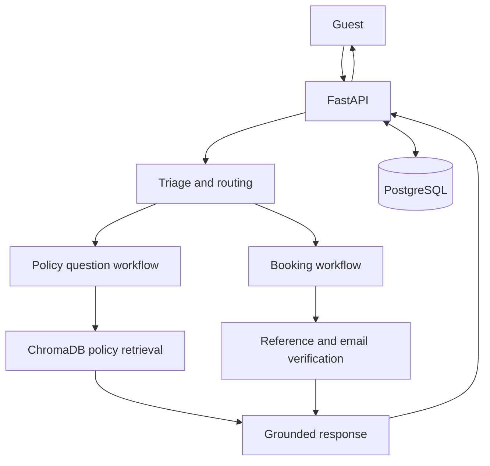

# PC Hotel Lahore AI Concierge

An AI-powered concierge and booking assistant for PC Hotel Lahore. Built with **LangGraph** and **FastAPI**, the system combines conversational AI with policy retrieval and booking workflows—while keeping guest sessions isolated and protecting sensitive actions with verification.

## Overview

The concierge helps guests get answers to hotel policy questions and navigate booking-related requests through a structured, multi-node agent architecture. A triage step routes incoming messages before they reach the relevant workflow. For policy questions, the system uses retrieval-augmented generation (RAG) to ground responses in hotel information. Booking verification requires both a booking reference and the associated email address.

## Key capabilities

- **Agent-based conversation flow** using LangGraph.
- **Request triage** to route guest messages to the appropriate workflow.
- **Policy retrieval** using RAG and ChromaDB.
- **Booking verification** using a booking reference and email address.
- **Stateless session isolation** to keep guest conversations separate.
- **FastAPI backend** for serving the application.
- **PostgreSQL persistence** for application data.

## Architecture

The triage step acts as a gatekeeper before requests enter downstream workflows. Policy responses are informed by retrieved hotel information, while booking-related actions require verification before proceeding.

## Technology stack

| Area | Technology |
|---|---|
| Agent orchestration | LangGraph |
| API | FastAPI |
| Relational database | PostgreSQL |
| Vector database | ChromaDB |
| Primary languages | Python, HTML, JavaScript, CSS |

## Security and privacy

The application is designed with safeguards for sensitive guest interactions:

- **Triage before workflow execution** helps prevent untrusted requests from being handled as ordinary instructions.
- **Two-factor booking verification** requires both a booking reference and email address.
- **Session isolation** is intended to prevent conversation state from leaking between guests.
- **Policy retrieval** grounds policy answers in the available hotel information rather than relying only on model knowledge.

These controls are part of the application’s design and should be reviewed alongside the implementation and deployment configuration.

## Core Features & User Journeys

- **Home & Quick Search (`home.html` / `index.html`):**
- Displays property highlights, rotating hero slides, check-in/check-out date pickers, and an interactive adults/children + child-ages drawer that syncs state across pages.

- Fetches featured rooms and add-on services from `/rooms/availability` and `/services` and renders hotel policy information.

- **Live Availability & Room Selection (`book.html`):**
- Queries `/rooms/availability` for chosen dates and guest counts, enforces check-out > check-in validation, and surfaces sold-out vs. available room counts with amenity chips and nightly pricing.

- Synchronizes date and party updates to URL query parameters and `localStorage` so room selection flows cleanly into reservation checkout.

- **Hold Creation & Checkout (`checkout.html` / `payment.html`):**
- Collects guest details, room quantity, add-on services, and policy acceptance to create an unpaid 2-hour reservation hold via `POST /bookings`.

- Tracks `hold_expires_at` with a live countdown timer and submits payments via `POST /bookings/{ref}/pay` using an `Idempotency-Key` header and confirmation code display.

- **My Bookings & Lifecycle Actions (`bookings.html`):**
- Displays reservation history, computed statuses, expandable room and add-on service breakdowns, and actions for paying unpaid holds, cancelling holds (`POST /bookings/{ref}/cancel`), and checking/requesting refunds.

- **Account & Profile Management (`login.html`, `profile-edit.html`, `change-password.html`):**
- Supports account sign-in/registration (including international phone input formatting), profile updates (`PUT /auth/profile`), and password changes (`POST /auth/change-password`) with session token handling.

- **Shared Runtime & Multi-Agent Chat Widget (`common.js`):**
- Wraps requests in `apiFetch` with `X-Session-Token`, session expiry handling, toast alerts, confirmation modals, and HTML escaping (`esc`).

- Provides a floating, expandable, draggable chat panel supporting thread history (`/chat/history`, `/chat/threads`, `/chat/new`), message submission (`/chat`), and markdown/table rendering.

---

## API & Agent Contract

### Key Backend Endpoints

- **Session & Auth:** `POST /sessions`, `POST /auth/login`, `POST /auth/register`, `POST /auth/logout`, `GET/PUT /auth/profile`, `POST /auth/change-password`

- **Catalog & Availability:** `GET /services`, `GET /rooms/availability`, `GET /rooms/calendar`

- **Bookings, Payment & Refunds:** `POST /bookings`, `GET /bookings`, `GET /bookings/{ref}`, `POST /bookings/{ref}/pay`, `POST /bookings/{ref}/cancel`, `POST /bookings/{ref}/refund`, `POST /bookings/claim`

- **Concierge Chat:** `POST /chat`, `GET /chat/history`, `GET /chat/threads`, `POST /chat/new`

### LangGraph Concierge Flow & Tools

- **Graph Pipeline:** Input guard (length and injection checks) $\rightarrow$ `triage` intent classification (`BOOKING`, `MY_BOOKINGS`, `SUPPORT`, `OTHER`) $\rightarrow$ specialized agent (`booking`, `my-bookings`, or `support` policy RAG) $\rightarrow$ `verifier` $\rightarrow$ ticket log.

- **Allowed Tools:** `search_availability`, `create_booking` (unpaid hold only), `list_my_bookings`, `explain_status`, and `search_policy` (with explicit confirmation required before cancel/refund actions, and no direct payment tool).

---

## Getting started

Setup commands and required configuration depend on the files and scripts in this repository. Before running the application:

1. Install the project’s dependencies.
2. Configure the required database and model-provider settings.
3. Start PostgreSQL and ChromaDB using your local or deployment setup.
4. Run the FastAPI application using the command defined by the project.

Check the application configuration and dependency files for the exact environment variable names and commands. Do not commit credentials or other secrets to the repository.

## Assumptions & Scope

- **Hold & Refund Defaults:** Unpaid holds last 2 hours before expiring while keeping booking history; refund tiers default to 100% ($\ge 7$ days before check-in), 50% (2–7 days), and 0% ($< 48$ hours), with stays that have already started ineligible for refund.

- **Check-in / Check-out & Pricing:** Standard check-in is from `14:00` and check-out until `12:00`, with room/service calculations performed in integer minor currency units (cents/paisa) and physical rooms assigned deterministically on the server.

- **v1 Scope Boundaries:** Focused on single-property room bookings, mock payment settlement, session-scoped access, and free/open-source tooling rather than a staff back-office dashboard, live merchant gateway, or multi-hotel tenancy.