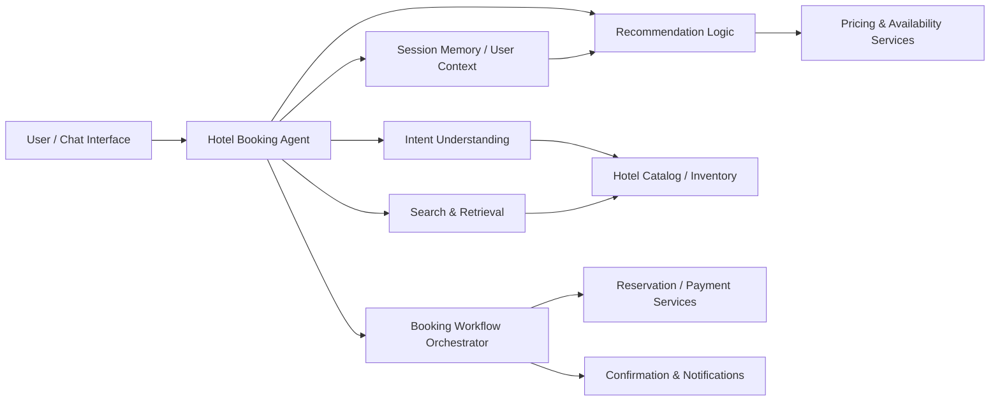

# Hotel Booking Agent

An AI-powered hotel booking assistant designed to help travelers discover, compare, and book accommodations using natural-language conversations. This project is structured around the concepts described in the HotelAgent Detailed Design v6.0 and is intended to serve as a clean foundation for a production-ready hotel concierge and booking workflow.

## Overview

The Hotel Booking Agent combines conversational interfaces, business rules, and hotel inventory systems to create a seamless booking experience. Instead of requiring users to navigate multiple tabs and filters manually, the system interprets user intent, searches relevant hotels, compares options, and helps complete the reservation flow in a guided and trustworthy way.

The system is designed for:

- Travel planning and hotel search
- Personalized accommodation recommendations
- Booking assistance with constraints and preferences
- Multistep flow orchestration from search to confirmation
- Integration with hotel inventory, pricing, payment, and guest profile services

## Why this project matters

Booking a hotel is often fragmented across search engines, mapping tools, booking platforms, and review sites. The Hotel Booking Agent centralizes this into a single conversational experience with:

- intent understanding
- policy-aware recommendations
- dynamic filtering based on traveler constraints
- transparent pricing and booking decisions
- resilient multi-step workflows

This README describes the core product vision, architecture, functional design, and operational model.

## Product goals

1. Help users quickly find hotels matching their preferences.
2. Reduce friction in planning and booking decisions.
3. Provide trustworthy, explainable recommendations.
4. Support both direct user interaction and backend orchestration.
5. Scale to multiple properties, cities, and booking scenarios.

## Core capabilities

### 1. Natural-language hotel search
Users can describe their needs in plain language, such as:

- "A family-friendly hotel in Dubai near the marina under $180/night"
- "A quiet boutique stay near downtown with free parking"
- "A luxury 5-star property with breakfast and airport transfer"

The system interprets these requests and translates them into structured search and filtering logic.

### 2. Preference-aware recommendation engine
The agent considers:

- destination and dates
- traveler count and room type
- budget tolerance
- hotel rating or star category
- amenities such as Wi-Fi, pool, parking, breakfast, and gym
- proximity to key locations
- traveler style such as business, family, luxury, or budget

### 3. Comparison and decision support
Users can compare alternatives based on:

- nightly price
- total booking cost
- cancellation terms
- reviews and ratings
- distance to destination
- amenities and room features

### 4. Booking flow orchestration
The system manages the booking journey across:

- hotel search
- property shortlist
- room selection
- rate validation
- guest details
- payment authorization
- confirmation generation

### 5. Policy and validation checks
The system helps ensure:

- valid travel dates and occupancy
- eligibility for selected room type and features
- minimum age or guest policies where applicable
- room availability and pricing consistency
- customer identity / payment checks if required

## High-level architecture

## System components

### User interaction layer
Responsible for capturing user requests and presenting replies in a conversational, friendly experience.

Key responsibilities:

- message parsing
- clarification prompts
- conversational state tracking
- result presentation and follow-up questions

### Intent and policy engine
Translates the user’s request into a formal action plan.

Examples:

- hotel search request
- price comparison request
- room-selection request
- booking confirmation intent

This layer also validates whether the user request is actionable and whether additional information is required.

### Search and retrieval layer
Queries relevant hotel records using destination, dates, filters, and user preferences.

This layer may source data from:

- internal hotel catalog
- third-party inventory providers
- pricing and availability APIs
- geospatial and property metadata services

### Recommendation and ranking layer
Ranks hotels based on fit, not just price. It may combine:

- relevance score
- user preference match
- quality/ratings
- price-to-value ratio
- availability confidence

### Booking orchestration layer
Coordinates the multi-step reservation creation process. This is the business-aware control plane that sequences the actions needed to finalize a booking.

### Persistence and context layer
Tracks:

- user session
- booking intent
- selected hotel and room
- previous conversation context
- partial bookings or abandoned flows

## Functional workflow

### Scenario: user wants a hotel in a destination

1. The user asks for a hotel using natural language.
2. The agent extracts destination, travel dates, occupancy, and budget.
3. It validates the request and checks for missing data.
4. The search layer queries hotel inventory and price data.
5. Recommendations are ranked based on user preferences.
6. The user reviews options and asks for more detail.
7. The agent provides comparison details.
8. The user selects a room and continues to booking.
9. The booking flow validates availability and policy constraints.
10. The system confirms the reservation and returns booking details.

## Data model concepts

The design generally requires a few core entities:

- User or traveler profile
- Hotel property
- Room offering
- Price and availability record
- Booking request
- Reservation confirmation
- Payment transaction
- Review / rating metadata

### Example conceptual entities

- Property: hotel identity, location, amenities, category, rating
- Room: room type, capacity, features, occupancy limits
- Rate: nightly rate, taxes, discounts, cancellation rules
- Booking: check-in/out, room, guest info, status, total paid
- Session: chat context, selected property, pending actions

## Business rules and validation

The system should explicitly enforce business rules such as:

- date validity and no impossible date ranges
- valid guest counts vs room capacity
- only show available properties
- apply price and tax formulas consistently
- prevent invalid booking transitions
- handle partial and failed reservation attempts gracefully

## Non-functional requirements

### Reliability
The platform should safely recover from transient service failures, not lose conversation state, and preserve the user’s progress.

### Scalability
The architecture should support expanding to more cities, providers, hotel records, and concurrent travelers.

### Security
Protect sensitive user and payment data using encrypted transport, secure storage patterns, and least-privilege access for internal services.

### Observability
Monitor:

- search latency
- recommendation quality
- booking success rate
- error rates by provider
- user abandonment points

### User trust
The agent should avoid misleading or overly aggressive recommendations. It should explain trade-offs and present pricing clearly.

## Recommended technologies

Although this repository may evolve across different implementations, the solution architecture typically fits well with:

- frontend or conversational UI
- backend service layer
- LLM orchestration or prompt-driven agent runtime
- hotel and pricing APIs
- relational or document database for booking and profile records
- monitoring and logging stack
- message queue or event-driven orchestration for async workflows

## Deployment model

The system can be deployed as:

- a web app with embedded chat UI
- a backend API service with agent orchestration
- a hybrid setup with provider integrations and orchestrated workflows

Typical deployment concerns:

- environment separation: dev/staging/prod
- provider credential management
- rate-limited API access
- failover for third-party booking systems
- audit logs for payment and reservation operations

## Development workflow

A production-ready delivery process should include:

- unit tests for recommendation and validation logic
- integration tests with booking APIs
- conversation flow regression tests
- security and privacy checks
- performance benchmarking for booking and search operations

## Example use cases

### Leisure traveler
A user wants a romantic hotel near the beach with a pool and breakfast for 3 nights under a specific budget.

### Business traveler
A user needs a hotel near a convention center with reliable Wi-Fi and late checkout.

### Family trip
A user is booking for 4 guests and wants family rooms, nearby attractions, and flexible cancellation.

### Last-minute travel
A user searches for available hotels in a city for tonight and needs quickly ranked options and fast booking decisions.

## Risks and considerations

- incomplete inventory data can lead to misleading recommendations
- policy inconsistencies across providers need to be normalized
- price volatility requires timely freshness checks
- user intent can be ambiguous and may need clarification
- payment and booking flows require careful error handling

## Roadmap

Potential future milestones:

- personalized traveler profiles
- loyalty program integration
- multilingual support
- dynamic price alerts
- itinerary-aware hotel recommendations
- mobile-first UX
- support for group bookings and corporate travel

## Contribution guidance

Contributions are welcome if they improve:

- booking workflow reliability
- recommendation quality
- API integration quality
- user experience and clarity
- testing and observability

Please keep changes aligned with the design principles of the HotelAgent Detailed Design v6.0 and ensure the system remains user-friendly and trustworthy.

## Summary

The Hotel Booking Agent is a conversational, policy-aware, and operationally robust solution for hotel search and reservation. It transforms fragmented travel planning into a guided experience that can help users quickly find suitable hotels, compare options, and confidently complete a booking.

This project represents a strong foundation for building a modern AI-driven accommodation assistant with real business value.

---

If you want, this README can also be adapted into a more technical version for engineers, a product-focused version for stakeholders, or a polished GitHub landing page with badges, screenshots, and a project architecture diagram.
